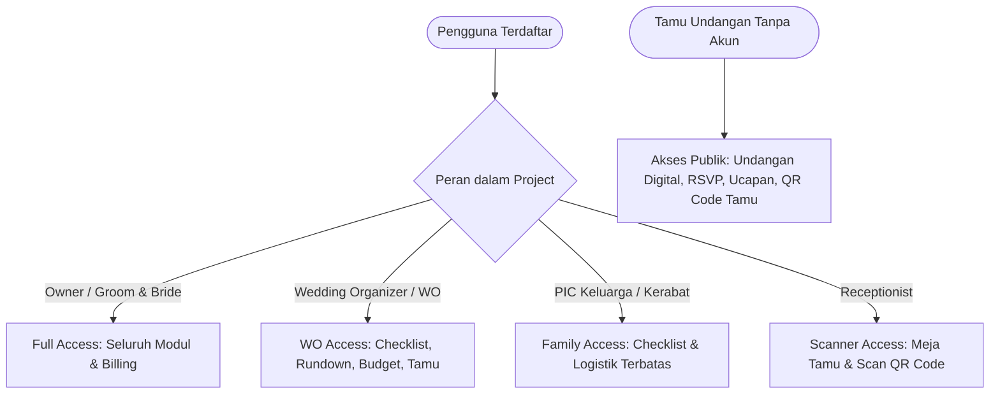
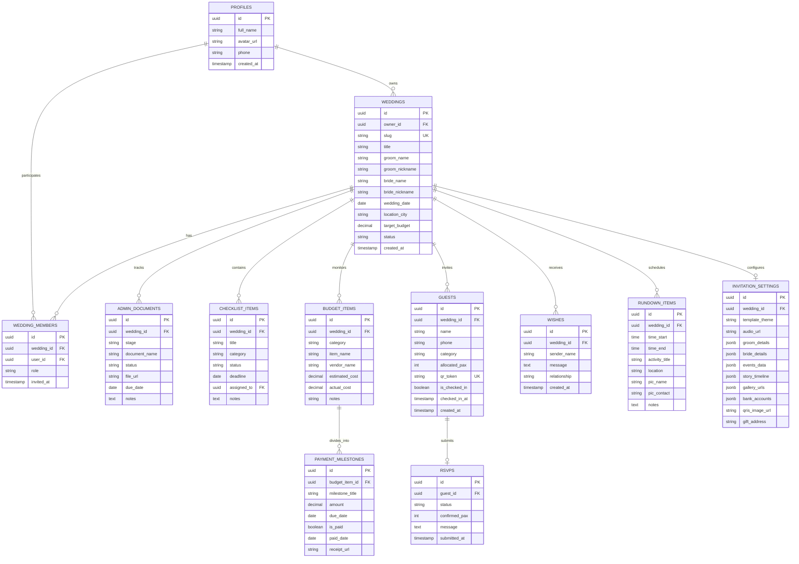
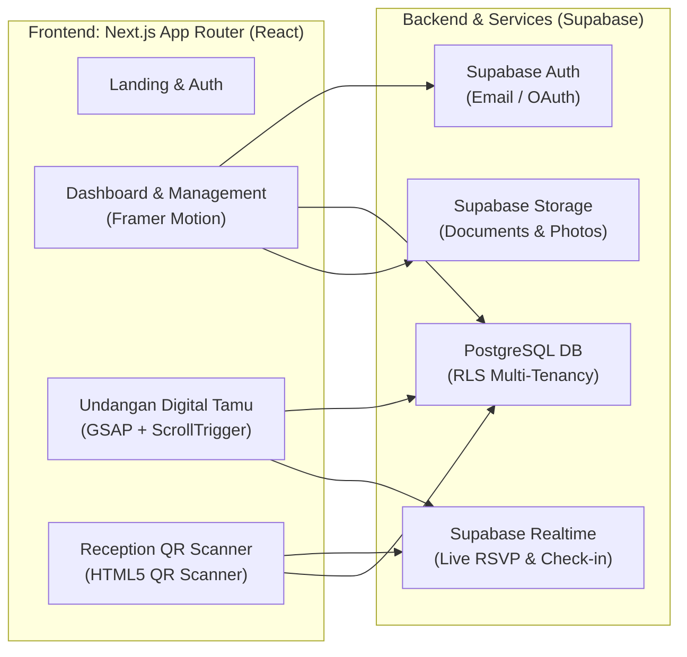

# Product Requirements Document (PRD) & Entity Relationship Diagram (ERD)

**Project:** RestuKisah
**Tagline:** *All-in-One Wedding Operating System & Luxury Digital Invitation Platform*
**Architecture:** Next.js (App Router) + Tailwind CSS + Supabase (PostgreSQL, RLS, Realtime, Storage) + Framer Motion & GSAP
**Target Pengguna:** Multi-Tenant SaaS (Calon Pengantin, Wedding Organizer, Tamu Undangan, Resepsionis Meja Tamu)

---

## 1. Executive Summary & Visi Produk

**RestuKisah** adalah platform SaaS manajemen pernikahan *all-in-one* yang menggabungkan dua kebutuhan utama industri pernikahan di Indonesia:

1. **Back-Office Management (Untuk Catin & WO):** Mengelola kerumitan birokrasi legalitas nikah (KUA/Disdukcapil), alur kerja to-do checklist, pelacakan anggaran (*budget & termin vendor*), dan manajemen rundown hari-H.
2. **Front-Facing Guest Experience (Untuk Tamu & Resepsi):** Undangan digital sinematik berbasis animasi GSAP/Framer Motion, generator tautan WhatsApp personal, konfirmasi RSVP real-time, amplop digital/QRIS, serta sistem *check-in* buku tamu menggunakan pemindaian QR Code di meja resepsi.

---

## 2. User Personas & Hak Akses (RBAC)



| Persona                                   | Kebutuhan Utama                                                                                         | Hak Akses (*Role*)      |
| :---------------------------------------- | :------------------------------------------------------------------------------------------------------ | :------------------------ |
| **Calon Pengantin (Groom & Bride)** | Kontrol penuh pernikahan, anggaran, transparansi berkas KUA, pemilihan tema undangan.                   | `owner` / `partner`   |
| **Wedding Organizer (WO)**          | Manajemen teknis: checklist persiapan, koordinasi vendor, rundown hari-H, rekap kehadiran tamu.         | `organizer`             |
| **PIC Keluarga / Sahabat**          | Membantu tugas spesifik (misal: logistik konsumsi, serah terima seserahan).                             | `collaborator`          |
| **Penerima Tamu (Receptionist)**    | Cepat melakukan validasi kehadiran tamu di lokasi acara tanpa akses ke data finansial pengantin.        | `receptionist`          |
| **Tamu Undangan (Guest)**           | Membuka undangan personal, melihat peta & cerita cinta, konfirmasi RSVP, kirim ucapan & amplop digital. | *Public (Token / Slug)* |

---

## 3. Spesifikasi Modul Fungsional (Feature Breakdown)

### Modul 1: Administrasi Pernikahan (Legal & KUA / Disdukcapil)

* **Alur Berkas Bertahap (Indonesia-Specific):**
  1. *Tahap 1: RT/RW & Kelurahan* (Surat Pengantar RT/RW, Formulir Model N1, N2, N4).
  2. *Tahap 2: Kesehatan* (Pemeriksaan Catin Puskesmas, Sertifikat Elsimil BKKBN, Vaksin TT).
  3. *Tahap 3: KUA / Disdukcapil* (Surat Rekomendasi Nikah jika numpang nikah, pas foto background biru, dispensasi nikah jika <10 hari kerja).
* **Fitur Utama:**
  * Checklist interaktif per tahapan birokrasi.
  * Status berkas: `Belum Diurus`, `Diproses`, `Selesai Verifikasi`.
  * *Document Vault:* Upload & simpan scan KTP, KK, Akta Lahir, Ijazah agar siap cetak sewaktu-waktu.
  * *Deadline Calculator:* Countdown otomatis batas waktu pendaftaran (minimal $H-10$ hari kerja).

### Modul 2: Wedding Checklist & Timeline Planner

* **Kategori To-Do:** *Venue, Catering, MUA & Attire, Dokumentasi, Hiburan & Sound, Dekorasi, Souvenir & Undangan, Legalitas, Logistik.*
* **Fitur Utama:**
  * Pengelompokan berbasis waktu: $H-12$ bln, $H-6$ bln, $H-3$ bln, $H-1$ bln, $H-1$ minggu, Hari-H.
  * Multi-view: Tampilan List & Tampilan Kanban Board (Framer Motion drag-and-drop).
  * Penugasan PIC (*Assignee*) ke Pengantin Pria, Pengantin Wanita, atau WO.

### Modul 3: Wedding Budget & Expense Tracker

* **Struktur Biaya:**
  * Input alokasi target anggaran total (misal: Rp 150.000.000).
  * Pemecahan kategori otomatis berdasarkan persentase rekomendasi industri (Catering ~40%, Venue ~20%, dll).
  * Tracking *Estimated Cost* vs *Actual Cost*.
* **Manajemen Termin Pembayaran (Payment Milestones):**
  * Pencatatan DP, Termin 1, Termin 2, dan Pelunasan per vendor.
  * Tanggal jatuh tempo & indikator status lunas/belum lunas.
  * Upload bukti transfer/kuitansi digital.

### Modul 4: Manajemen Tamu, Buku Tamu & QR Check-In

* **Daftar Tamu (Guest List):**
  * Kategori tamu (*VIP, Keluarga Inti, Teman Kantor, Sahabat, Tetangga*).
  * Alokasi jumlah pax (misal: "Budi Santoso + 1").
  * WhatsApp Message Generator: Pembuat tautan pesan WhatsApp personal otomatis (contoh: *"Kepada Yth. Budi Santoso, kami mengundang Anda..."* dengan URL langsung berparameter `?to=Budi+Santoso`).
* **RSVP Real-Time:**
  * Tamu dapat mengonfirmasi: *Hadir*, *Tidak Hadir*, *Ragu-ragu* beserta jumlah pax yang akan datang.
* **Sistem Check-In Meja Resepsi:**
  * Setiap tamu memiliki `qr_code_token` unik.
  * Di hari-H, petugas meja tamu membuka scanner kamera web (`/check-in`) untuk memindai QR tamu.
  * Dashboard resepsi langsung menampilkan total tamu hadir vs kuota catering secara real-time via Supabase Realtime.

### Modul 5: Mesin Undangan Digital Publik (GSAP & Framer Motion)

* **Struktur Tampilan Undangan:**
  * *Animated Opening Envelope:* Amplop mewah terbuka dengan animasi GSAP sebelum masuk ke konten utama.
  * *Music Background:* Pemutar musik dengan tombol play/pause mengambang.
  * *Hero Banner:* Hitung mundur (*live countdown*), nama kedua mempelai, tanggal & lokasi.
  * *Profil Mempelai:* Foto, nama lengkap, nama orang tua, tautan media sosial.
  * *Cerita Cinta (Love Story):* Timeline perjalanan hubungan dengan efek scroll-trigger.
  * *Detail Acara:* Akad / Pemberkatan & Resepsi + Tombol Google Maps / Kalender.
  * *Galeri Foto & Video:* Tampilan foto lightbox & parallax scroll.
  * *Amplop Digital & Kado:* Nomor rekening bank (tombol salin nomor), QRIS interaktif, dan alamat pengiriman kado.
  * *Kolom Ucapan & Doa (Wishes):* Tamu dapat mengirim doa, langsung ter-render realtime dengan confetti effect.

### Modul 6: Rundown & Guidebook Hari-H

* Jadwal kegiatan menit demi menit (05:00 Makeup, 07:30 Persiapan Akad, 08:00 Ijab Kabul, dst).
* Pemetaan PIC penanggung jawab per aktivitas & kontak darurat vendor.
* Fitur *One-Click Export PDF* untuk dibagikan ke seluruh panitia dan keluarga.

---

## 4. Entity Relationship Diagram (ERD)



---

## 5. Skema Keamanan & Multi-Tenancy (Supabase Row Level Security)

Sistem menggunakan isolasi data multi-tenant dengan aturan RLS (Row Level Security):

```sql
-- Contoh Kebijakan Akses Weddings
CREATE POLICY "Users can access weddings they own or belong to" 
ON public.weddings
FOR ALL 
USING (
  auth.uid() = owner_id 
  OR EXISTS (
    SELECT 1 FROM public.wedding_members 
    WHERE wedding_members.wedding_id = weddings.id 
    AND wedding_members.user_id = auth.uid()
  )
);

-- Undangan Publik & Buku Tamu (Guest View)
CREATE POLICY "Public can view active wedding invitations by slug"
ON public.invitation_settings
FOR SELECT
USING (true);

-- Check-in & Tamu
CREATE POLICY "Receptionists & Organizers can update check-in status"
ON public.guests
FOR UPDATE
USING (
  EXISTS (
    SELECT 1 FROM public.wedding_members
    WHERE wedding_members.wedding_id = guests.wedding_id
    AND wedding_members.user_id = auth.uid()
    AND wedding_members.role IN ('owner', 'partner', 'organizer', 'receptionist')
  )
);
```

---

## 6. Arsitektur Komponen & Teknologi



---

## 7. Roadmap Rencana Implementasi

1. **Sprint 1: Foundational Setup & Schema**
   * Setup proyek Next.js 14/15, Tailwind CSS, Lucide Icons, Framer Motion, GSAP.
   * Konfigurasi Supabase Client & SQL Schema Migrations (Tabel, Enum, RLS).
   * Mock Data generator untuk kemudahan pengujian.
2. **Sprint 2: Dashboard Core (Administrasi, Checklist & Budget)**
   * Layout navigasi dashboard (*Responsive Sidebar, Wedding Switcher*).
   * Modul Checklist dengan drag-and-drop / Kanban & filter kategori.
   * Modul Administrasi Berkas KUA/Catatan Sipil dengan timeline tracker.
   * Modul Budget Tracker & pelacakan termin vendor.
3. **Sprint 3: Manajemen Tamu & Meja Resepsi (QR Check-In)**
   * CRUD Tamu, alokasi pax, dan generator tautan WhatsApp otomatis.
   * QR Code token generator unik per tamu.
   * Halaman pemindai QR meja resepsi (`/check-in`) dengan audio *beep feedback* & hitungan real-time.
4. **Sprint 4: Mesin Undangan Digital Interaktif (Public View)**
   * Komponen cover animasi buka amplop mewah (*GSAP Cinematic Reveal*).
   * Audio player melayang, countdown timer, peta acara, galeri prewedding.
   * Formulir RSVP & formulir ucapan doa real-time dengan confetti.
5. **Sprint 5: Rundown & Finishing Polish**
   * Modul Rundown menit demi menit dengan export format cetak/PDF.
   * Testing alur multi-user & role permissions.
