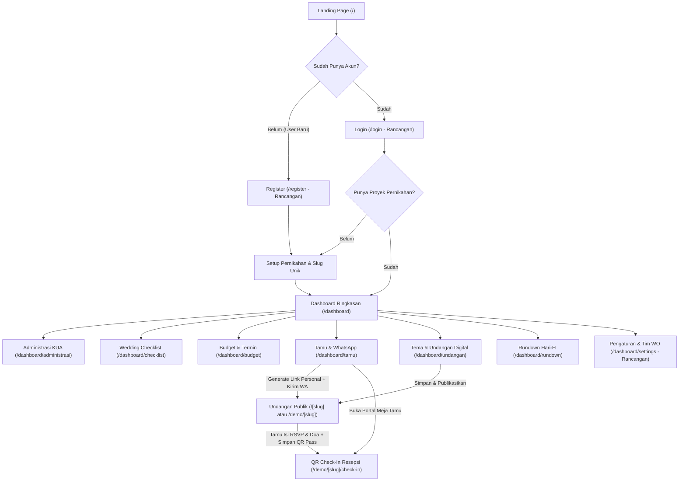
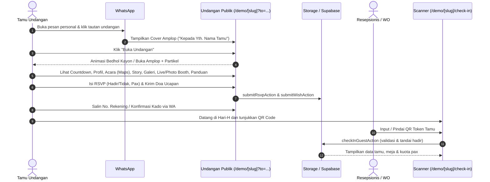

# Alur Penggunaan & Analisis Perbaikan Aplikasi **RestuKisah**

Dokumen ini memetakan **alur penggunaan aplikasi RestuKisah secara lengkap** (mulai dari pengguna biasa/calon pengantin hingga tamu dan petugas meja resepsi) sekaligus menyajikan **hasil audit teknis dan logika** berdasarkan pemeriksaan langsung terhadap kode sumber (`src/`), skema basis data (`supabase/`), serta dokumentasi rancangan ([PRD_and_ERD.md](file:///c:/Copy/Local%20Disk%20(H)/Project/Website/antigravity/restuKisah/docs/PRD_and_ERD.md) dan [flow.md](file:///c:/Copy/Local%20Disk%20(H)/Project/Website/antigravity/restuKisah/flow.md)).

> [!IMPORTANT]
> **Realita Kondisi Kode Saat Ini vs Rancangan Target:**
> Saat ini aplikasi memiliki antarmuka dashboard dan mesin undangan digital (khususnya tema Adat Jawa Keraton) yang sangat matang secara visual, tetapi **lapisan autentikasi (`/login`, `/register`), manajemen akun (`/dashboard/settings`), sinkronisasi penuh ke Supabase, dan beberapa aksi CRUD/upload masih berupa prototipe berbasis `localStorage` dan data dummy**. Pada Bagian 1 dijelaskan alur ideal beserta catatan kondisi aktualnya di kode, lalu pada Bagian 2 dijabarkan seluruh temuan cacat logika dan solusinya.

---

## Bagian 1: Alur Penggunaan Aplikasi (End-to-End User Flow)

### Peta Alur Keseluruhan Sistem

---

### 1.1 Alur User Biasa: Landing Page, Register, Login & Onboarding

#### A. Alur Ideal (Sesuai Rancangan PRD & ERD)
1. **Akses Landing Page (`/`):** Calon pengantin membuka halaman utama untuk melihat ringkasan fitur (KUA Vault, Checklist, Budget, Undangan Digital, QR Check-In, Rundown) dan dapat mencoba pratinjau undangan melalui tombol **"Lihat Contoh Undangan"**.
2. **Register (`/register`):**
   - User mengklik **"Mulai Rencanakan"** / **"Mulai Buat Proyek Pernikahan"**.
   - Mengisi **Nama Lengkap, Email, Password** (atau **Google OAuth**).
   - Supabase Auth membuat akun di `auth.users`, lalu trigger database `handle_new_user()` otomatis membuat baris di tabel `public.profiles`.
3. **Onboarding Setup Pernikahan:**
   - User baru diarahkan ke modal/halaman *Setup Pernikahan* untuk mengisi: Nama Lengkap & Panggilan Mempelai Pria & Wanita, Tanggal Rencana Akad/Resepsi, Kota Lokasi, Target Anggaran (*Target Budget*), dan **Slug URL Undangan** (contoh: `dian-bayu`).
   - Sistem menyimpan ke `public.weddings`, menambahkan user ke `wedding_members` (`role: 'owner'`), dan men-seed data awal (berkas KUA, checklist standar Indonesia, serta pengaturan undangan awal).
4. **Login (`/login`):**
   - User lama masuk menggunakan Email/Password atau OAuth.
   - Sistem memverifikasi sesi, mengambil daftar proyek pernikahan tempat user terdaftar sebagai `owner`, `partner`, `organizer`, `collaborator`, atau `receptionist`, lalu mengarahkan ke `/dashboard`.

#### B. Kondisi Saat Ini di Kode Aktual
- Di [page.tsx](file:///c:/Copy/Local%20Disk%20(H)/Project/Website/antigravity/restuKisah/src/app/page.tsx#L53-L65), seluruh tombol **"Masuk"** dan **"Mulai Rencanakan"** langsung mengarah ke `/dashboard` karena halaman `/login` dan `/register` belum dibuat.
- Saat masuk ke `/dashboard`, [DashboardContext.tsx](file:///c:/Copy/Local%20Disk%20(H)/Project/Website/antigravity/restuKisah/src/components/dashboard/DashboardContext.tsx#L59) otomatis memuat `weddingId = 'wed-001-dian-bayu'` (data dummy *Dian & Bayu* dari [mock-data.ts](file:///c:/Copy/Local%20Disk%20(H)/Project/Website/antigravity/restuKisah/src/lib/mock-data.ts#L12-L26)) dan menyimpannya ke `localStorage`.

---

### 1.2 Alur Manajemen Dashboard

Setelah masuk ke area dashboard ([Sidebar.tsx](file:///c:/Copy/Local%20Disk%20(H)/Project/Website/antigravity/restuKisah/src/components/dashboard/Sidebar.tsx#L21-L64)), user dapat mengelola seluruh persiapan pernikahan melalui 7 halaman berikut:

#### 1. Overview (`/dashboard` — [dashboard/page.tsx](file:///c:/Copy/Local%20Disk%20(H)/Project/Website/antigravity/restuKisah/src/app/dashboard/page.tsx))
- **Hero Countdown Banner:** Menampilkan nama kedua mempelai, tanggal & lokasi acara, serta kotak hitung mundur (Hari, Jam, Menit).
- **4 Kartu Statistik Reaktif:**
  - *Berkas KUA:* Rasio dokumen berstatus selesai (`docsCompleted / docsTotal`) dan persentase kesiapan.
  - *Checklist To-Do:* Progres tugas selesai (`tasksCompleted / tasksTotal`).
  - *Total Kontrak:* Total realisasi biaya vendor dibandingkan dengan plafon `target_budget`.
  - *Buku Tamu:* Jumlah tamu terkonfirmasi hadir (`attending`) dan jumlah tamu yang sudah *check-in* di resepsi.
- **Panel Aksi Cepat:**
  - *Tugas Prioritas Mendatang:* Menampilkan 3 tugas teratas yang bisa langsung dicentang dari overview + pengingat batas daftar SIMKAH KUA.
  - *Termin Tagihan Vendor:* Menampilkan hingga 3 termin pembayaran vendor yang belum lunas (`!is_paid`).
- **Tautan Cepat Publik:** Tombol **Salin Tautan**, **Pratinjau** (membuka `/demo/[slug]`), dan **Meja Tamu** (membuka `/demo/[slug]/check-in`).

#### 2. Administrasi KUA (`/dashboard/administrasi` — [administrasi/page.tsx](file:///c:/Copy/Local%20Disk%20(H)/Project/Website/antigravity/restuKisah/src/app/dashboard/administrasi/page.tsx))
1. User melihat banner ketentuan pendaftaran KUA (paling lambat $H-10$ hari kerja) beserta *progress bar* kelengkapan berkas.
2. User memfilter berkas berdasarkan **4 tahapan birokrasi Indonesia**:
   - `1. RT/RW` (Surat pengantar RT & RW domisili)
   - `2. Kelurahan (N1-N4)` (Formulir Model N1, N2, N4)
   - `3. Kesehatan (Elsimil/TT)` (Sertifikat Elsimil BKKBN & Vaksin Tetanus Toksoid di Puskesmas)
   - `4. KUA SIMKAH` (Pas foto latar biru 2x3 & 4x6, pendaftaran SIMKAH, surat rekomendasi numpang nikah)
3. Pada setiap kartu dokumen, user menekan tombol status untuk memutar progres secara berurutan:
   `Belum` (`not_started`) $\rightarrow$ `Proses` (`in_progress`) $\rightarrow$ `Siap Kirim` (`ready_to_submit`) $\rightarrow$ `Selesai` (`completed`).
4. Terdapat tombol **"Upload Scan"** untuk menyimpan salinan berkas *(catatan audit: tombol saat ini belum memiliki handler unggah file)*.

#### 3. Wedding Checklist (`/dashboard/checklist` — [checklist/page.tsx](file:///c:/Copy/Local%20Disk%20(H)/Project/Website/antigravity/restuKisah/src/app/dashboard/checklist/page.tsx))
1. User melihat total tugas selesai dan *progress bar* kesiapan acara.
2. User menyaring daftar tugas berdasarkan pill milestone waktu (`Semua`, `H-10 Bulan`, `H-8 Bulan`, `H-6 Bulan`, `H-4 Bulan`, `H-2 Bulan`, `H-2 Minggu`).
3. User menekan kartu tugas atau kotak centang untuk menandai tugas **Selesai / Belum Selesai** (otomatis memperbarui statistik di Overview).
4. Untuk menambah tugas baru, user mengklik **"Tambah Tugas"**, mengisi **Judul Tugas**, **Kategori** (*Venue & Dekorasi, Catering & Kue, MUA & Busana, Dokumentasi, Undangan & Tamu, Logistik & Lainnya*), dan **Target Waktu**, lalu klik **"Simpan Tugas"**.

#### 4. Budget & Termin Vendor (`/dashboard/budget` — [budget/page.tsx](file:///c:/Copy/Local%20Disk%20(H)/Project/Website/antigravity/restuKisah/src/app/dashboard/budget/page.tsx))
1. User memantau 4 kartu ringkasan keuangan: **Target Anggaran (Plafon)**, **Total Realistis Kontrak**, **Sudah Dibayarkan (DP/Termin)**, dan **Sisa Wajib Dilunasi**.
2. Di bagian *Jadwal Termin Pembayaran Vendor*, setiap item anggaran menampilkan daftar terminnya (misal: *DP Booking 30%*, *Termin II 50%*, *Pelunasan H-7 30%*) lengkap dengan nominal dan tanggal jatuh tempo.
3. User menekan **"Tandai Lunas ✓"** atau **"Batal Lunas"** untuk memperbarui status pembayaran termin, yang langsung menghitung ulang total sudah dibayar dan sisa tagihan.
4. Tersedia tombol **"Kuitansi"** untuk lampiran bukti bayar *(catatan audit: tombol saat ini belum memiliki modal upload/lihat bukti bayar)*.

#### 5. Tamu & WhatsApp (`/dashboard/tamu` — [tamu/page.tsx](file:///c:/Copy/Local%20Disk%20(H)/Project/Website/antigravity/restuKisah/src/app/dashboard/tamu/page.tsx))
1. **Tambah Tamu:** Klik **"Tambah Tamu"**, lalu isi Nama Tamu/Pasangan, Kategori (`umum`, `vip`, `keluarga`, `sahabat`, `teman_kantor`, `tetangga`), Alokasi Pax, Nomor WhatsApp, dan Nomor Meja. Sistem otomatis menghasilkan `qr_token` unik.
2. **Pencarian & Filter:** User dapat mencari berdasarkan nama atau nomor HP dan memfilter berdasarkan kategori tamu.
3. **Kirim Undangan WhatsApp Personal:** Klik **"Kirim WA"** pada baris/kartu tamu $\rightarrow$ sistem membentuk tautan pesan otomatis (`https://wa.me/{phone}?text=...`) yang berisi salam hormat personal, info acara, serta URL undangan dengan parameter `?to={Nama_Tamu}`.
4. **Tiket QR & Meja Resepsi:** Klik **"QR Tiket"** untuk menampilkan pop-up tiket masuk tamu, atau klik **"Buka Scanner Meja Resepsi"** untuk menuju portal check-in hari-H.

#### 6. Memilih Tema & Mengatur Undangan Digital (`/dashboard/undangan` — [undangan/page.tsx](file:///c:/Copy/Local%20Disk%20(H)/Project/Website/antigravity/restuKisah/src/app/dashboard/undangan/page.tsx))
Halaman ini memiliki banner tautan publik + tombol **Salin Link** dan **Lihat Pratinjau Live**, serta **5 tab konfigurasi**:
1. **Tab `Tema & Tampilan`:**
   - Memilih 1 dari 3 tema: **Adat Jawa Keraton (`jawa_parchment`)**, **Soft Neobrutalism Modern (`soft_neobrutalism`)**, atau **Classic Royal Elegance (`classic_luxury`)**.
   - Jika memilih `jawa_parchment`, muncul panel konfigurasi tambahan: *Mode Sampul Pembuka* (`adat_jawa_cover` Bedhol Kayon vs `classic_arch`), *Efek Partikel Latar* (`pink_blossoms`, `gold_butterflies`, `white_jasmine`, `none`), *URL Musik Pengiring Gamelan*, dan centang aktif/nonaktif *Virtual Photo Booth*.
2. **Tab `Kedua Mempelai`:** Mengisi data Mempelai Pria (CPP) & Mempelai Wanita (CPW): Nama Lengkap & Gelar, Nama Panggilan, Urutan Anak, Nama Ayah, Nama Ibu, dan Username Instagram.
3. **Tab `Rangkaian Acara`:** Mengelola daftar acara (Akad Nikah, Resepsi, Unduh Mantu, atau tambah/hapus acara): Judul acara, tanggal, waktu pelaksanaan, nama gedung, alamat lengkap, dan tautan Google Maps.
4. **Tab `Amplop & Kado`:** Menambah/menghapus rekening bank tujuan amplop digital (BCA, Mandiri, BRI, BNI, BSI, Jago, nomor rekening, nama pemilik, badge label), alamat pengiriman kado fisik, dan nomor WhatsApp penerima konfirmasi transfer.
5. **Tab `Panduan & Live`:** Mengisi URL YouTube Live Streaming, URL Zoom Meeting, Meeting ID, dan Passcode Zoom.
6. **Simpan:** Menekan tombol **"Simpan Perubahan Undangan"** di sticky bottom bar $\rightarrow$ menyimpan ke `localStorage` (dengan broadcast sinkronisasi lintas tab) serta melakukan upsert ke tabel-tabel Supabase melalui `saveWeddingInvitationData()`.

#### 7. Rundown Hari-H (`/dashboard/rundown` — [rundown/page.tsx](file:///c:/Copy/Local%20Disk%20(H)/Project/Website/antigravity/restuKisah/src/app/dashboard/rundown/page.tsx))
- User melihat susunan acara berurutan menit demi menit beserta rentang waktu (`WIB`), judul aktivitas, lokasi, dan nama PIC penanggung jawab.
- Klik **"Cetak / Simpan PDF"** untuk memanggil dialog cetak browser (`window.print()`) guna dibagikan ke tim WO dan keluarga.

---

### 1.3 Alur Lainnya: Pengalaman Tamu Publik, Check-In Hari-H & Kolaborasi Tim

1. **Alur Tamu Undangan (`/demo/[slug]` atau `/demo/jawa`):**
   - Pada tema **Adat Jawa Keraton** ([JavaneseParchmentTemplate.tsx](file:///c:/Copy/Local%20Disk%20(H)/Project/Website/antigravity/restuKisah/src/components/templates/JavaneseParchmentTemplate.tsx)), tamu melewati: Cover (Gebyok Bedhol Kayon / Classic Arch) $\rightarrow$ Animasi Gunungan & Efek Burst $\rightarrow$ 12 Seksi Lengkap (*Hero & Countdown + Save to Google Calendar*, *Quote Ayat*, *Profil Mempelai*, *Jadwal & Maps*, *Love Story*, *Galeri Foto & Video Lightbox*, *Live Streaming & Virtual Photo Booth 3 Frame Interaktif*, *Dresscode Swatches & Etika + Keluarga Turut Mengundang*, *Konfirmasi RSVP*, *Amplop Digital & Alamat Kado*, *Gift Confirm via WA + Lampiran Foto Bukti TF*, *Ucapan Doa + Confetti*, dan *Closing Matur Nuwun*).
2. **Alur Resepsionis Meja Tamu (`/demo/[slug]/check-in`):**
   - Petugas memantau total tamu hadir dan total pax masuk secara *real-time*.
   - Petugas memasukkan `qr_token` (atau menekan tombol simulasi cepat) $\rightarrow$ sistem memvalidasi apakah token terdaftar dan belum pernah *check-in* sebelumnya, lalu menampilkan hasil sukses (hijau), sudah check-in (kuning), atau tidak valid (merah).
3. **Alur Kolaborasi Multi-Peran (Rancangan di PRD & Schema):**
   - `owner` / `partner` (Calon Pengantin) mengelola seluruh modul dan mengundang anggota lain.
   - `organizer` (WO) membantu mengelola checklist, rundown, vendor, dan tamu.
   - `collaborator` (Keluarga) membantu logistik/checklist terbatas.
   - `receptionist` hanya mengakses portal scanner check-in tanpa melihat data keuangan.
   *(Catatan: UI undangan kolaborator, switcher proyek pernikahan, dan pembatasan akses per peran belum diimplementasikan di frontend).*

---

## Bagian 2: Analisis Perbaikan & Penambahan (Efektivitas, Efisiensi & Bebas Cacat Logika)

Hasil audit terhadap kode saat ini menunjukkan sejumlah **cacat logika kritis**, **celah keamanan RLS/autentikasi**, **fitur setengah jadi (tombol dummy)**, dan **peluang efisiensi lintas modul**.

---

### 2.1 Cacat Logika & Bug Kritis yang Harus Segera Diperbaiki

#### 1. Benturan Identitas Pernikahan (`dian-bayu` vs `miko-angela`) & Tautan Publik 404
- **Masalah di Kode:**
  - Dashboard memuat `mockWedding` ([mock-data.ts](file:///c:/Copy/Local%20Disk%20(H)/Project/Website/antigravity/restuKisah/src/lib/mock-data.ts#L12-L16)) dengan `id: 'wed-001-dian-bayu'` dan `slug: 'dian-bayu'` (*Dian & Bayu*).
  - Namun ketika [undangan/page.tsx](file:///c:/Copy/Local%20Disk%20(H)/Project/Website/antigravity/restuKisah/src/app/dashboard/undangan/page.tsx#L44) memanggil `getWeddingInvitationBySlug('dian-bayu')`, data tidak ditemukan di Supabase sehingga fallback mengembalikan `mockJavaneseWeddingData` (*Miko & Angela*, `slug: 'miko-angela'`) di [mock-data-jawa.ts](file:///c:/Copy/Local%20Disk%20(H)/Project/Website/antigravity/restuKisah/src/lib/mock-data-jawa.ts#L4-L6). Saat disimpan, payload `miko-angela` tersimpan di key `wed-001-dian-bayu`, sehingga profil di sidebar/overview tertulis **Dian & Bayu**, tetapi editor & pratinjau menampilkan **Miko & Angela**.
  - Tautan yang disalin di [dashboard/page.tsx](file:///c:/Copy/Local%20Disk%20(H)/Project/Website/antigravity/restuKisah/src/app/dashboard/page.tsx#L36) dan pesan WhatsApp di [tamu/page.tsx](file:///c:/Copy/Local%20Disk%20(H)/Project/Website/antigravity/restuKisah/src/app/dashboard/tamu/page.tsx#L60) adalah `https://restukisah.id/${wedding.slug}` (`/dian-bayu`), sedangkan rute `src/app/[slug]/page.tsx` **belum ada** (yang tersedia hanya `/demo/[slug]`), sehingga link dari WhatsApp menghasilkan **404**.
  - Halaman [check-in/page.tsx](file:///c:/Copy/Local%20Disk%20(H)/Project/Website/antigravity/restuKisah/src/app/demo/[slug]/check-in/page.tsx#L18) mengabaikan parameter `slug` URL dan men-hardcode `const weddingId = mockWedding.id;`.
- **Perbaikan:**
  - Buat rute publik resmi `src/app/[slug]/page.tsx` dan `src/app/[slug]/check-in/page.tsx` (pertahankan `/demo/*` hanya untuk showcase marketing).
  - Resolve `weddingId` secara dinamis dari `slug` pada undangan publik maupun scanner check-in.
  - Samakan *Single Source of Truth* data profil, tanggal, dan acara antara modul Dashboard (`weddings`) dan modul Undangan (`wedding_couples`, `wedding_events`).

#### 2. `Invalid Date` pada Countdown Tema Jawa & Data Hardcoded di Dashboard/Non-Jawa
- **Masalah di Kode:**
  - Di [JavaneseParchmentTemplate.tsx](file:///c:/Copy/Local%20Disk%20(H)/Project/Website/antigravity/restuKisah/src/components/templates/JavaneseParchmentTemplate.tsx#L450), `targetDateISO` dibangun dari `${invitationData.events[0].date}T${invitationData.events[0].time?.slice(0,5) || '09:00'}:00`. Karena `events[0].date` berisi teks Indonesia (`'Sabtu, 21 Juni 2025'`) dan `time` memakai titik (`'08.00 – 10.00 WIB'`), hasil string `'Sabtu, 21 Juni 2025T08.00:00'` menghasilkan `Invalid Date` (`NaN`) pada `new Date(...)` di [RoyalJavaneseHeroCountdown.tsx](file:///c:/Copy/Local%20Disk%20(H)/Project/Website/antigravity/restuKisah/src/components/templates/jawa/RoyalJavaneseHeroCountdown.tsx#L64). Akibatnya countdown langsung jatuh ke `00:00:00:00` dan generator Google Calendar gagal parse tanggal.
  - Di [dashboard/page.tsx](file:///c:/Copy/Local%20Disk%20(H)/Project/Website/antigravity/restuKisah/src/app/dashboard/page.tsx#L63-L85), [Sidebar.tsx](file:///c:/Copy/Local%20Disk%20(H)/Project/Website/antigravity/restuKisah/src/components/dashboard/Sidebar.tsx#L119), [Header.tsx](file:///c:/Copy/Local%20Disk%20(H)/Project/Website/antigravity/restuKisah/src/components/dashboard/Header.tsx#L46), [rundown/page.tsx](file:///c:/Copy/Local%20Disk%20(H)/Project/Website/antigravity/restuKisah/src/app/dashboard/rundown/page.tsx#L34), dan [tamu/page.tsx](file:///c:/Copy/Local%20Disk%20(H)/Project/Website/antigravity/restuKisah/src/app/dashboard/tamu/page.tsx#L61), tanggal `"Sabtu, 19 Desember 2026"` dan countdown `"78 Hari : 14 Jam : 35 Menit"` **di-hardcode** di tampilan JSX, tidak dihitung dari `wedding.wedding_date`.
  - Di [demo/[slug]/page.tsx](file:///c:/Copy/Local%20Disk%20(H)/Project/Website/antigravity/restuKisah/src/app/demo/[slug]/page.tsx#L165-L350), tampilan non-Jawa mengabaikan `invitationData` dan men-hardcode nama `mockWedding`, rekening `1234 5678 90 a.n. Bayu Pratama`, dan link Google Maps generik.
- **Perbaikan:**
  - Simpan tanggal acara dalam format ISO (`YYYY-MM-DD`) dan waktu (`HH:MM`) secara terpisah (sesuai tipe `DATE` dan `TIME` di SQL), lalu format ke bahasa Indonesia hanya di layer tampilan UI.
  - Hitung countdown di Dashboard dan Undangan secara dinamis dari `wedding.wedding_date` / `event_date` + `start_time`.
  - Buat komponen template terpisah yang membaca `invitationData` untuk `soft_neobrutalism` dan `classic_luxury` (saat ini `classic_luxury` yang dipilih di [undangan/page.tsx](file:///c:/Copy/Local%20Disk%20(H)/Project/Website/antigravity/restuKisah/src/app/dashboard/undangan/page.tsx#L283) tidak memiliki komponen renderer sama sekali).

#### 3. Ketidakcocokan Token QR Tamu & QR Code / Scanner Masih Simulasi
- **Masalah di Kode:**
  - Di [tamu/page.tsx](file:///c:/Copy/Local%20Disk%20(H)/Project/Website/antigravity/restuKisah/src/app/dashboard/tamu/page.tsx#L446) dan [demo/[slug]/page.tsx](file:///c:/Copy/Local%20Disk%20(H)/Project/Website/antigravity/restuKisah/src/app/demo/[slug]/page.tsx#L309), QR Code **bukan QR Code asli yang bisa dipindai**, melainkan ikon SVG statis `<QrCode />` dari `lucide-react`.
  - Token yang dirender di undangan publik (`TOKEN-${guestName.replace(/\s+/g, '').toUpperCase().slice(0, 8)}`) **tidak cocok** dengan `qr_token` tamu di database (`TOKEN-BUDI-VIP01` atau `TOKEN-BUDISANT-1234`). Jika dipindai di `/check-in`, tamu akan ditolak sebagai token tidak valid!
  - Halaman [check-in/page.tsx](file:///c:/Copy/Local%20Disk%20(H)/Project/Website/antigravity/restuKisah/src/app/demo/[slug]/check-in/page.tsx#L152-L160) belum mengaktifkan kamera perangkat (`html5-qrcode`) dan belum mengeluarkan suara *beep* seperti yang dijanjikan di landing page.
- **Perbaikan:**
  - Gunakan query parameter bertoken unik untuk setiap tamu dari WA Generator, misalnya `https://restukisah.id/{slug}?t={qr_token}` (fallback `?to=` untuk tamu tanpa token), lalu render nama dan `qr_token` asli dari tabel `guests`.
  - Gunakan pustaka generator QR sungguhan (seperti `qrcode.react` / `qrcode`) dan `html5-qrcode` + Web Audio API untuk suara *beep* di `/check-in`.

#### 4. Cacat Logika Pencocokan RSVP, Foreign Key Supabase & Sinkronisasi Ucapan
- **Masalah di Kode:**
  - `submitRsvpAction()` di [wedding-data-service.ts](file:///c:/Copy/Local%20Disk%20(H)/Project/Website/antigravity/restuKisah/src/lib/wedding-data-service.ts#L263-L320) mencocokkan tamu berdasarkan kesamaan string nama persis (`g.name.toLowerCase().trim() === guestName.toLowerCase().trim()`). Jika tamu menulis nama singkat di form RSVP (misal `"Budi"` untuk `"Budi Santoso & Partner"`), sistem membuat entri tamu duplikat (`gst-auto-...`), sehingga jumlah tamu dan kuota pax membengkak salah.
  - Saat mengirim ke Supabase (`supabase.from('rsvps').insert(...)`), jika tamu belum ada di list, kode mengirim `guest_id: 'guest-temp-...'` yang **bukan UUID valid** dan **tidak ada di tabel `guests`**, sehingga pasti gagal *Foreign Key constraint*. Selain itu, karena `rsvps.guest_id` bertipe `UNIQUE` ([schema.sql](file:///c:/Copy/Local%20Disk%20(H)/Project/Website/antigravity/restuKisah/supabase/schema.sql#L163)), tombol **"Ubah Konfirmasi"** pada [RoyalJavaneseRsvpConfirmation.tsx](file:///c:/Copy/Local%20Disk%20(H)/Project/Website/antigravity/restuKisah/src/components/templates/jawa/RoyalJavaneseRsvpConfirmation.tsx#L536) akan gagal jika melakukan `insert` kedua kalinya (harus `upsert`).
  - Di [RoyalJavaneseWishesGuestbook.tsx](file:///c:/Copy/Local%20Disk%20(H)/Project/Website/antigravity/restuKisah/src/components/templates/jawa/RoyalJavaneseWishesGuestbook.tsx#L88), `useState<WishItem[]>(defaultWishes)` tidak memiliki `useEffect` sinkronisasi ketika prop `defaultWishes` berubah — akibatnya doa yang dikirim lewat form RSVP atau dari tab lain tidak langsung muncul di daftar doa tema Jawa tanpa reload halaman.
- **Perbaikan:**
  - Ikat pengiriman RSVP dengan `guest_id` / `qr_token` jika tamu membuka lewat tautan personal; jika tamu publik tanpa token, buat baris `guests` terlebih dahulu (atau pisahkan alur RSVP publik berstatus *pending verifikasi*) lalu lakukan `upsert` ke `rsvps` berdasarkan `guest_id`.
  - Sinkronkan `wishes` dengan `defaultWishes` di `RoyalJavaneseWishesGuestbook.tsx` dan tambahkan validasi `confirmed_pax <= allocated_pax` (atau peringatan jika melebihi kuota meja).

#### 5. Fitur Musik Latar Belum Berfungsi
- **Masalah di Kode:**
  - Di [JavaneseParchmentTemplate.tsx](file:///c:/Copy/Local%20Disk%20(H)/Project/Website/antigravity/restuKisah/src/components/templates/JavaneseParchmentTemplate.tsx#L114) dan [demo/[slug]/page.tsx](file:///c:/Copy/Local%20Disk%20(H)/Project/Website/antigravity/restuKisah/src/app/demo/[slug]/page.tsx#L67), tombol Volume hanya mengubah state boolean `isPlayingMusic`, tetapi **tidak ada elemen `<audio>` atau Web `Audio()`** yang memutar file musik. File `/templates/jawa/audio/gamelan-royal-wedding.mp3` juga belum tersedia di direktori `public/`.
- **Perbaikan:** Tambahkan ref `<audio ref={audioRef} src={resolvedAudioUrl} loop />` yang dikendalikan oleh tombol *"Buka Undangan"* (memenuhi kebijakan *autoplay-on-user-gesture* browser modern) dan tombol *floating mute/unmute*, serta sediakan aset audio default atau pengunggah audio di `/dashboard/undangan`.

#### 6. Cacat Logika di Modul Budget, Checklist, Tamu & Simpan Template
| Modul | Cacat Logika / Bug yang Ditemukan | Dampak & Perbaikan |
| :--- | :--- | :--- |
| **Budget** ([budget/page.tsx](file:///c:/Copy/Local%20Disk%20(H)/Project/Website/antigravity/restuKisah/src/app/dashboard/budget/page.tsx)) | 1. `totalUnpaid = totalActual - totalPaid` (L26), tetapi item tanpa milestone (`bg-5` Dekorasi Rp 18 Jt) di-skip dari UI (`if (!item.milestones \|\| ...) return null` di L106). 2. Saat overbudget (`budgetRemaining < 0`), L62 tetap menampilkan teks hijau `"Hemat Rp -X.X Jt"` dengan ikon centang. 3. Pembagian `totalPaid / totalActual` menghasilkan `NaN%` jika `totalActual === 0`. | Tagihan Rp 18 Jt ada di angka utang tetapi tidak bisa dilunasi di layar! Tampilkan seluruh item budget meskipun belum ada termin, perbaiki status overbudget menjadi merah `"Melebihi Plafon"`, dan lindungi pembagian dengan nol. |
| **Checklist** ([checklist/page.tsx](file:///c:/Copy/Local%20Disk%20(H)/Project/Website/antigravity/restuKisah/src/app/dashboard/checklist/page.tsx)) | 1. Filter milestone hanya berisi `['all', 'H-10 Bulan', 'H-8 Bulan', 'H-6 Bulan', 'H-4 Bulan', 'H-2 Bulan', 'H-2 Minggu']` (L52), sedangkan modal Tambah Tugas menyediakan `'H-12 Bulan'`, `'H-3 Bulan'`, `'H-1 Bulan'`, `'Hari-H'` (L244-250). 2. Status `in_progress` hilang saat diklik karena `toggleChecklistAction` hanya men-toggle `'todo' <-> 'done'`. 3. `deadline` hardcoded `'2026-11-01'`. | Tugas baru dengan default `'H-3 Bulan'` tidak punya tab filter! Hasilkan filter secara dinamis atau samakan daftar konstanta timeframe, dukung 3 status (`todo` $\rightarrow$ `in_progress` $\rightarrow$ `done`) + Kanban view, dan tambahkan input tanggal deadline. |
| **Tamu & WA** ([tamu/page.tsx](file:///c:/Copy/Local%20Disk%20(H)/Project/Website/antigravity/restuKisah/src/app/dashboard/tamu/page.tsx)) | 1. Filter kategori (L124) tidak mencantumkan `'tetangga'` dan `'umum'` (padahal `'umum'` adalah default saat tambah tamu). 2. Nomor HP lokal (`0812...`) tidak dinormalisasi ke `62812...` untuk `wa.me`. | Tamu baru kategori `'umum'` tidak tampil saat user mengklik filter selain `'Semua'`; link `wa.me/0812...` gagal dibuka di WhatsApp. Tambahkan semua enum `guest_category` di filter & sanitasi nomor telepon otomatis. |
| **Simpan Undangan** ([invitation-service.ts](file:///c:/Copy/Local%20Disk%20(H)/Project/Website/antigravity/restuKisah/src/lib/invitation-service.ts)) | 1. `saveWeddingInvitationData` L303 mengirim string teks (`"Sabtu, 21 Juni 2025"`) ke kolom `DATE` dan memecah `ev.time.split('-')` padahal mock memakai en-dash `–`. 2. `saveWeddingInvitationData` tidak menyimpan `loveStories` dan `gallery`, serta belum menangani `physicalGift` jika array bank kosong. 3. Properti `coupleTitle` di [RoyalJavaneseHeroCountdown.tsx](file:///c:/Copy/Local%20Disk%20(H)/Project/Website/antigravity/restuKisah/src/components/templates/jawa/RoyalJavaneseHeroCountdown.tsx#L94-L106) membalik urutan nama (`Miko & Angela` dirender menjadi `ANGELA & MIKO`). 4. Pada cover `classic_arch` di [JavaneseParchmentTemplate.tsx](file:///c:/Copy/Local%20Disk%20(H)/Project/Website/antigravity/restuKisah/src/components/templates/JavaneseParchmentTemplate.tsx#L396-L405), komponen memakai `heroImage`, `coupleTitle`, dan `weddingDate` mentah alih-alih `resolved*`. | Query upsert/insert ke `wedding_events` akan gagal di PostgreSQL dan perubahan Love Story/Galeri tidak tersimpan. Gunakan input `type="date"` dan `type="time"`, lengkapi payload simpan seluruh tabel, dan konsisten memakai variabel `resolved*`. |

---

### 2.2 Celah Keamanan, Autentikasi & Row Level Security (RLS)

> [!CAUTION]
> **Risiko Kebocoran & Penolakan Data di Production Supabase:**
> Jika skema saat ini langsung dijalankan di production Supabase, beberapa operasi dashboard akan ditolak RLS sementara data sensitif tamu dan anggaran pengantin justru terekspos ke publik.

1. **Kebocoran Data Publik di [schema.sql](file:///c:/Copy/Local%20Disk%20(H)/Project/Website/antigravity/restuKisah/supabase/schema.sql):**
   - Policy `Public can view guest info by token` (L281-282) memakai `USING (true)` sehingga siapa saja bisa melakukan query `SELECT * FROM guests` lewat anon key dan mencuri **seluruh daftar nama + nomor WhatsApp pribadi tamu**. *Solusi:* Gunakan RPC/Server Route `SECURITY DEFINER` atau view publik yang hanya mengembalikan data tamu ketika `qr_token` spesifik diberikan.
   - Policy `Public can view weddings by slug` (L267-268) memakai `USING (status != 'archived')`, yang mengekspos `target_budget` dan `owner_id` ke publik. *Solusi:* Batasi akses publik lewat `public_wedding_invitations` view atau Next.js Server Component / Route Handler yang hanya memilih kolom publik.
   - Policy `Public can update own RSVP` (L294-295) memakai `USING (true)` sehingga orang asing dapat mengubah RSVP tamu lain. *Solusi:* Wajibkan validasi `qr_token` atau RPC server-side untuk update RSVP.
2. **RLS Terkunci / Tidak Lengkap:**
   - Tabel `wedding_members` mengaktifkan RLS (L229) **tanpa satu pun policy** — semua query ke tabel anggota akan gagal.
   - Ketujuh tabel pada migrasi [20261126_add_template_jawa_tables.sql](file:///c:/Copy/Local%20Disk%20(H)/Project/Website/antigravity/restuKisah/supabase/migrations/20261126_add_template_jawa_tables.sql#L180-L204) hanya memiliki policy `FOR SELECT USING (true)`, tanpa policy `FOR ALL` untuk member/owner (`is_wedding_member(wedding_id)`). Akibatnya `saveWeddingInvitationData()` pasti ditolak Supabase.
3. **Trigger `seed_default_wedding_data()` Belum Lengkap:**
   - Trigger di [schema.sql](file:///c:/Copy/Local%20Disk%20(H)/Project/Website/antigravity/restuKisah/supabase/schema.sql#L342-L372) belum memasukkan `owner` ke `wedding_members` dan belum membuat baris awal di `wedding_template_settings`, `wedding_couples`, serta `wedding_guest_guides`.
4. **Penulisan Database Tidak Terverifikasi (`localStorage`-first):**
   - [wedding-data-service.ts](file:///c:/Copy/Local%20Disk%20(H)/Project/Website/antigravity/restuKisah/src/lib/wedding-data-service.ts#L386-L520) tidak pernah membaca data awal dari Supabase dan memanggil `.update()` / `.insert()` tanpa `await` di dalam `try/catch` kosong. Jika gagal di server, user tidak pernah tahu data hanya tersimpan di browser lokalnya.
   - [client.ts](file:///c:/Copy/Local%20Disk%20(H)/Project/Website/antigravity/restuKisah/src/lib/supabase/client.ts#L4-L5) memakai fallback URL dummy `'https://mock-project.supabase.co'`. Sebaiknya pisahkan eksplisit mode *Demo Offline* vs *Production Supabase* agar bug environment tidak tersamar.
5. **Validasi URL Eksternal:**
   - Input `googleMapsUrl`, `youtubeUrl`, `zoomUrl`, dan `audioUrl` belum divalidasi protokolnya (`https://` / relative path `/`), sehingga berisiko menerima skema `javascript:` pada elemen tautan.

---

### 2.3 Perbaikan Efektivitas (Menuntaskan Fitur yang Masih Dummy / Parsial)

1. **Implementasi Auth, Proteksi Rute & Halaman Pengaturan (`/login`, `/register`, `middleware.ts`, `/dashboard/settings`):**
   - Lindungi semua rute `/dashboard/*` dengan `@supabase/ssr` server client & middleware.
   - Tambahkan halaman `/dashboard/settings` untuk mengubah profil pernikahan (nama mempelai, tanggal, kota, plafon anggaran, slug dengan cek ketersediaan unik), mengundang Pasangan / WO / Keluarga / Resepsionis, serta mengaktifkan **Wedding Switcher** di sidebar (khususnya penting untuk akun Wedding Organizer yang menangani banyak pengantin).
   - Terapkan penegakan hak akses di UI maupun backend (misalnya role `receptionist` tidak dapat membuka `/dashboard/budget` atau mengubah pengaturan undangan).
2. **Aktifkan Unggah Berkas Nyata via Supabase Storage:**
   - **Administrasi KUA:** Aktifkan tombol **"Upload Scan"** untuk upload KTP, KK, N1-N4, dan Elsimil (PDF/gambar) lengkap dengan preview & hapus.
   - **Budget & Termin:** Aktifkan tombol **"Kuitansi"** untuk upload bukti transfer/invoice tiap termin pembayaran.
   - **Editor Undangan:** Tambahkan pengunggah foto mempelai, cover, galeri prewedding, QRIS, dan file audio MP3 di `/dashboard/undangan`.
3. **Lengkapi CRUD di Seluruh Modul Dashboard:**
   - **Budget:** Tambah form atur Plafon Anggaran, Tambah/Edit/Hapus Pos Vendor (`BudgetItem`), dan Tambah/Edit/Hapus Termin Pembayaran (`PaymentMilestone`).
   - **Checklist:** Tambahkan Papan Kanban 3 kolom (*To Do*, *In Progress*, *Done*), form Edit/Hapus tugas, input catatan, pemilihan tanggal deadline, dan dropdown PIC anggota tim.
   - **Rundown:** Tambahkan form Tambah/Edit/Hapus/Urutkan jadwal, tampilkan `pic_contact` & `notes` yang sudah ada di skema database, serta tambahkan CSS `@media print` agar saat **Cetak / Simpan PDF** elemen Sidebar dan Header tidak ikut tercetak.
   - **Editor Undangan:** Tambahkan tab/bagian editor untuk **Cerita Cinta (Love Story)**, **Galeri Foto & Video**, **Kutipan Ayat/Quote**, **Panduan Dresscode & Etika**, serta **Daftar Keluarga Turut Mengundang**.

---

### 2.4 Rekomendasi Penambahan Fitur agar Jauh Lebih Efisien

1. **Smart Onboarding & Auto-Generator Lintas Modul:**
   - Saat user mengisi tanggal akad & target anggaran pada onboarding:
     - *Checklist* dibuat adaptif sesuai sisa waktu menuju Hari-H (jika pernikahan tinggal 2 bulan, tugas berlabel `H-12 Bulan` ditandai sebagai prioritas segera, bukan jatuh tempo masa lalu).
     - *Administrasi KUA* otomatis menghitung tanggal batas pendaftaran **10 hari kerja sebelum akad** (memperhitungkan hari Senin–Jumat), bukan teks statis.
     - *Budget Planner* menawarkan preset alokasi otomatis persentase industri (Catering 40%, Venue 20%, Dekorasi 12%, MUA & Busana 10%, Dokumentasi 10%, Cadangan 8%) yang dapat disesuaikan.
2. **Single Source of Truth & Integrasi Antar-Modul:**
   - **Undangan $\leftrightarrow$ Dashboard:** Mengubah tanggal acara, lokasi gedung, atau nama mempelai di Pengaturan Pernikahan otomatis memperbarui template WhatsApp di modul Tamu, Rundown, dan Undangan Publik.
   - **Budget $\leftrightarrow$ Checklist:** Termin pembayaran vendor yang akan jatuh tempo ($H-7$) otomatis muncul di widget *Tugas Prioritas* dan notifikasi lonceng di [Header.tsx](file:///c:/Copy/Local%20Disk%20(H)/Project/Website/antigravity/restuKisah/src/components/dashboard/Header.tsx#L50-L56) (saat ini ikon lonceng belum memiliki panel notifikasi).
   - **Tamu/RSVP $\leftrightarrow$ Budget Catering:** Menampilkan indikator peringatan di Dashboard jika total `confirmed_pax` dari RSVP mendekati atau melebihi kuota porsi Catering yang dipesan.
   - **Gift Confirm $\leftrightarrow$ Rekap Amplop Masuk:** Tabel `wedding_gift_confirmations` sudah ada di migrasi SQL, namun belum tersambung ke `RoyalJavaneseGiftConfirm` maupun ditampilkan sebagai **Rekap Hadiah & Amplop Masuk** di Dashboard Pengantin.
3. **Administrasi KUA yang Akurat untuk Kondisi Indonesia:**
   - Pisahkan dokumen tahap RT/RW, Kelurahan, dan Puskesmas menjadi **Checklist Mempelai Pria (CPP)** dan **Checklist Mempelai Wanita (CPW)** karena pasangan di Indonesia kerap berbeda kecamatan/domisili.
   - Tambahkan wizard kondisi khusus (*Numpang Nikah*, *Dispensasi < 10 Hari Kerja*, *Pernikahan Non-Muslim via Disdukcapil*, atau *Status Duda/Janda/TNI-Polri*) sehingga daftar dokumen yang muncul relevan dengan kondisi pengguna.
4. **Efisiensi Blast Tamu & Manajemen Meja Hari-H:**
   - **Import Massal CSV/Excel:** Mengunggah ratusan kontak tamu sekaligus dibanding input satu per satu.
   - **Tracking Status Kirim WA & Filter Follow-Up:** Menandai tamu mana yang sudah dikirimi undangan WA (`is_invited_sent`, `invited_at`), sehingga mudah memfilter tamu yang *Belum Dikirim* atau *Belum RSVP* untuk pengingat $H-7$.
   - **Kustomisasi Template Pesan WA:** Menyediakan editor template pesan (Formal, Islami, Kasual) dengan variabel `{nama_tamu}`, `{link_undangan}`, `{jadwal_acara}`.
   - **Check-In Tamu Walk-In & Un-Check-In:** Di meja resepsi hari-H, petugas sering menghadapi tamu yang lupa membawa HP atau tamu mendadak tanpa undangan; sediakan fitur **Pencarian Nama Manual + Check-In**, **Tambah Tamu Walk-In Cepat**, serta tombol **Batalkan Check-In** jika salah pindai.
