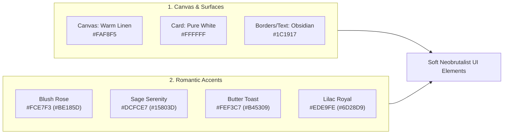

# RestuKisah Design System: Soft Neobrutalism
**Codename:** *Warm Brutalism for Weddings*  
**Platform:** Next.js (App Router), Tailwind CSS, Framer Motion, GSAP, Lucide Icons  
**Target:** Dashboard Pengantin & WO, Portal Meja Resepsi, & Design Token Generator  

---

## 1. Filosofi & Visi Desain

### Konsep: *"Warm & Tactile Editorial"*
Pernikahan adalah momen sakral dan emosional, namun persiapan teknisnya (anggaran, birokrasi KUA, daftar tamu) sering kali memicu stres tinggi. 

**Soft Neobrutalism** pada RestuKisah hadir untuk memecahkan masalah ini dengan pendekatan:
1. **Stress-Relieving & Playful:** Antarmuka terasa seperti papan permainan fisik yang menyenangkan untuk dicentang (*gamified checklist & budget*).
2. **High-Clarity Ergonomics:** Garis tegas (2px) dan kontras tinggi membuat data mudah dibaca di layar smartphone, bahkan di bawah sinar matahari saat mengecek lokasi venue.
3. **Warmth & Romance (The "Soft" Aspect):** Alih-alih warna kuning neon dan sudut tajam seperti brutalism murni, RestuKisah memakai sudut membulat lembut (*rounded-xl*), palet linen, *dusty rose*, *sage green*, dan sentuhan tipografi *editorial serif* yang anggun.

---

## 2. Palet Warna & Token Semantik (Color Tokens)



### 2.1 Palet Dasar (Neutrals & Structure)
* **Background Utama (Canvas):** `#FAF8F5` (`stone-50` berkarakter hangat, seperti kertas linen undangan).
* **Surface Kartu (Cards & Modals):** `#FFFFFF` (Putih bersih dengan border hitam tegas).
* **Border & Garis Stroke:** `#1C1917` (Deep Obsidian / Espresso; solid, tidak kabur).
* **Teks Utama (Primary):** `#1C1917` (`stone-900` untuk legibilitas maksimal).
* **Teks Sekunder (Muted):** `#57534E` (`stone-600` untuk deskripsi dan metadata).

### 2.2 Warna Aksen Semantik (Pastel Terkurasi)

| Kategori Token | Hex Background | Hex Teks/Ikon | Peruntukan Semantik di RestuKisah |
| :--- | :--- | :--- | :--- |
| **`accent-rose` (Romance / Hero)** | `#FCE7F3` | `#9D174D` | Profil pengantin, countdown hari-H, aksi utama, undangan publik. |
| **`accent-sage` (Success / Done)** | `#DCFCE7` | `#15803D` | Checklist selesai, pembayaran status *Lunas*, tamu terverifikasi hadir. |
| **`accent-butter` (Warning / Todo)** | `#FEF3C7` | `#B45309` | Peringatan jatuh tempo DP/termin vendor, dokumen KUA menunggu giliran. |
| **`accent-lavender` (VIP / WO Role)** | `#EDE9FE` | `#6D28D9` | Badge tamu VIP, PIC Wedding Organizer, fitur eksklusif. |
| **`accent-sky` (Info / Bureaucracy)** | `#E0F2FE` | `#0369A1` | Modul berkas RT/RW, Puskesmas/Elsimil, catatan logistik. |

---

## 3. Tipografi Hibrida (Typography System)

RestuKisah mengombinasikan ketajaman font geometris modern dengan keanggunan font serif editorial:

```
[Heading Editorial: Playfair Display / Cormorant Garamond] -> Jiwa Romantis & Anggun
[UI & Body Text: Plus Jakarta Sans / Inter]               -> Ergonomis & Bersih
[Numerik & Badge: JetBrains Mono / Geist Mono]             -> Data Angka & Jam Akurat
```

### Skala Tipografi:
* **Display / Hero (40px – 48px, Bold, Serif):** Nama kedua mempelai, total anggaran, sisa hari pernikahan.
* **Heading 1 / H1 (28px – 32px, Bold, Serif/Sans):** Judul halaman (*Administrasi*, *Budget Planner*, *Buku Tamu*).
* **Heading 2 / H2 (20px – 24px, Semi-Bold, Sans):** Judul grup (*Dokumen Kelurahan*, *Kategori Catering*).
* **Body Regular (15px – 16px, Normal, Sans):** Teks instruksi, form input, catatan aktivitas.
* **Caption / Meta (12px – 13px, Medium, Monospace/Sans):** Jam rundown (e.g. `08:00 - 09:30`), tag status, token QR.

---

## 4. Sistem Border, Radius, & Hard Shadow (The Neobrutalist Engine)

Ciri khas utama neobrutalism terletak pada perhitungan bayangan tanpa blur (*hard shadow*) dan interaksi taktil fisik (*physically pressable*).

### 4.1 Border & Radius
* **Border Standard:** `2px solid #1C1917` (`border-2 border-stone-900`).
* **Border Halus (Badge/Inner Tag):** `1.5px solid #1C1917`.
* **Border Radius (The "Soft" Touch):**
  * Kartu & Box Kontainer: `rounded-xl` (12px) atau `rounded-2xl` (16px).
  * Tombol Aksi: `rounded-xl` (10px–12px).
  * Status Pill / Badge: `rounded-full`.

### 4.2 Sistem Bayangan Fisik (Hard Shadows)
```css
/* Token Shadow Neobrutalis */
--shadow-sm: 2px 2px 0px 0px #1C1917;
--shadow-md: 4px 4px 0px 0px #1C1917;
--shadow-lg: 6px 6px 0px 0px #1C1917;
--shadow-xl: 8px 8px 0px 0px #1C1917;
```

---

## 5. Spesifikasi Komponen UI (Interactive Components)

### 5.1 Tombol (Tactile Pressable Buttons)
Tombol memiliki mekanisme fisik 3D: saat ditekan, elemen bergerak ke arah kanan-bawah dan bayangan hilang.

* **Primary Action Button (Rose Romance):**
  * Class: `bg-rose-400 text-stone-900 font-bold border-2 border-stone-900 rounded-xl px-5 py-3 shadow-[4px_4px_0px_0px_#1C1917] hover:shadow-[5px_5px_0px_0px_#1C1917] active:translate-x-1 active:translate-y-1 active:shadow-none transition-all`
* **Secondary / Card Button (Pure White):**
  * Class: `bg-white text-stone-900 font-semibold border-2 border-stone-900 rounded-xl px-4 py-2.5 shadow-[3px_3px_0px_0px_#1C1917] active:translate-x-1 active:translate-y-1 active:shadow-none transition-all`
* **Success Button (Sage):**
  * Class: `bg-emerald-300 text-stone-900 font-bold border-2 border-stone-900 rounded-xl px-4 py-2 shadow-[3px_3px_0px_0px_#1C1917]`

### 5.2 Kartu Data & Statistik (Metric Cards)
* Background: `#FFFFFF`
* Border: `border-2 border-stone-900`
* Radius: `rounded-2xl`
* Shadow: `shadow-[4px_4px_0px_0px_#1C1917]`
* Header Aksentuasi: Diberi pita warna pastel atau stiker badge di pojok kanan atas.

### 5.3 Form Input & Search
* Input text tidak memakai border tipis abu-abu standar.
* Default: `border-2 border-stone-900 rounded-xl bg-white px-4 py-3 text-stone-900 shadow-[2px_2px_0px_0px_#1C1917]`
* Focus State: `focus:bg-stone-50 focus:shadow-[4px_4px_0px_0px_#1C1917] focus:outline-none`

### 5.4 Badge & Pill Status
* Berbentuk lonjong (`rounded-full`) dengan border `1.5px solid #1C1917`.
* Contoh:
  * Status Lunas: `bg-emerald-100 text-emerald-900 border-2 border-stone-900 px-3 py-1 text-xs font-bold`
  * Status Pending: `bg-amber-100 text-amber-900 border-2 border-stone-900 px-3 py-1 text-xs font-bold`
  * Tamu VIP: `bg-purple-100 text-purple-900 border-2 border-stone-900 px-3 py-1 text-xs font-bold`

---

## 6. Animasi & Interaksi Gerak (Motion Specs)

### 6.1 Dashboard UI (Framer Motion)
* **Button Tap Physics:**
  ```tsx
  <motion.button
    whileHover={{ y: -2, x: -2 }}
    whileTap={{ y: 2, x: 2, boxShadow: "0px 0px 0px 0px #1C1917" }}
    transition={{ type: "spring", stiffness: 400, damping: 20 }}
  >
    Simpan Perubahan
  </motion.button>
  ```
* **Modal Dialog Reveal:**
  * Muncul dengan efek pop spring dari skala 0.95 ke 1.0 dengan bayangan `shadow-[8px_8px_0px_0px_#1C1917]`.

### 6.2 Undangan Publik (GSAP & ScrollTrigger)
* Animasi buka segel lilin (*wax seal unseal*) dan amplop terbuka dengan kurva *ease* sinematik (`power2.inOut`).
* Scroll parallax halus pada bingkai foto bergaya polaroid dengan border neobrutalis.

---

## 7. Ikonografi & Ornamen Grafis

* **Library Ikon:** **Lucide React**.
* **Ketebalan Garis Ikon:** Wajib menggunakan `strokeWidth={2.2}` atau `strokeWidth={2.5}` agar selaras dengan garis border 2px neobrutalis.
* **Elemen Dekoratif Tambahan:**
  * *Washi Tape Accent:* Stiker dekoratif sudut kartu (seperti selotip kertas dekorasi).
  * *Sticker Badges:* Tag miring 3 derajat (`rotate-[-3deg]`) untuk elemen penting seperti "H-30 HARI LAGI!" atau "URGENT DOKUMEN".

---

## 8. Snippet Konfigurasi `tailwind.config.ts`

```typescript
import type { Config } from "tailwindcss";

const config: Config = {
  content: [
    "./pages/**/*.{js,ts,jsx,tsx,mdx}",
    "./components/**/*.{js,ts,jsx,tsx,mdx}",
    "./app/**/*.{js,ts,jsx,tsx,mdx}",
  ],
  theme: {
    extend: {
      colors: {
        canvas: "#FAF8F5",
        ink: "#1C1917",
        wedding: {
          blush: "#FCE7F3",
          rose: "#FDA4AF",
          sage: "#DCFCE7",
          butter: "#FEF3C7",
          lavender: "#EDE9FE",
          sky: "#E0F2FE",
        },
      },
      fontFamily: {
        sans: ["var(--font-jakarta)", "sans-serif"],
        serif: ["var(--font-playfair)", "serif"],
        mono: ["var(--font-mono)", "monospace"],
      },
      boxShadow: {
        hard: "4px 4px 0px 0px #1C1917",
        "hard-sm": "2px 2px 0px 0px #1C1917",
        "hard-lg": "6px 6px 0px 0px #1C1917",
        "hard-xl": "8px 8px 0px 0px #1C1917",
      },
      borderWidth: {
        DEFAULT: "2px",
        "3": "3px",
      },
    },
  },
  plugins: [],
};

export default config;
```

---

## 9. Sistem Desain Responsif Lintas Perangkat (Multi-Device Ergonomics)

Sebanyak **85% - 95%** tamu undangan dan calon pengantin di Indonesia mengakses platform melalui smartphone (layar 360px - 430px). Oleh karena itu, prinsip desain **Mobile-First** wajib diterapkan tanpa mengorbankan fungsionalitas desktop untuk Wedding Organizer.

### 9.1 Matriks Breakpoint Standar
| Device Tier | Breakpoint (Tailwind) | Rentang Layar | Karakteristik Penggunaan |
| :--- | :--- | :--- | :--- |
| **Mobile Compact** | `< 640px` (Default) | 360px – 430px | 1 tangan / *thumb-zone*, navigasi drawer/bottom, kartu 1 kolom. |
| **Mobile Large / Tablet Mini** | `sm:` | 640px – 767px | Phablet & layar horizontal, 2 kolom grid dasar. |
| **Tablet Portrait / iPad** | `md:` | 768px – 1023px | Layar tablet meja resepsi, sidebar collapsible, 2-3 kolom grid. |
| **Laptop / Desktop Standard** | `lg:` | 1024px – 1279px | Monitor kerja pengantin/WO, persistent sidebar 72 (18rem). |
| **Wide Desktop** | `xl:` & `2xl:` | 1280px+ | Layar penuh ultra-wide, dashboard terpusat max-w-7xl. |

### 9.2 Aturan Ergonomi Sentuh (Touch-First & Thumb-Zone)
1. **Minimum Touch Target:**
   * Semua tombol aksi utama dan checkbox wajib memiliki area sentuh minimal **44px × 44px** (`min-h-[44px] min-w-[44px]`), mencegah salah pencet di layar HP.
2. **Viewport Height Adaptif (`100dvh`):**
   * Halaman cover undangan publik menggunakan `min-h-[100dvh]` (bukan `100vh`) agar tidak tertutup oleh *address bar* dinamis pada browser Safari iOS & Chrome Android.
3. **Hard Shadow Responsif:**
   * Pada layar kecil (`< 640px`), hindari `shadow-hard-xl` yang dapat menyebabkan kartu meluap keluar layar (*overflow horizontal*).
   * Gunakan `shadow-hard-sm` (2px) atau `shadow-hard` (4px) di mobile, dan perbesar menjadi `shadow-hard-lg` (6px) di layar desktop.

### 9.3 Pola Navigasi Responsif
* **Desktop (`≥ 1024px` / `lg`):** Sidebar statis permanen selebar `w-72` di sebelah kiri dengan navigasi penuh.
* **Mobile & Tablet (`< 1024px`):**
  * Sidebar disembunyikan secara default (`hidden lg:flex`).
  * Header menampilkan **Tombol Hamburger (Menu)** di kiri atas.
  * Saat tombol ditekan, sidebar muncul sebagai **Slide-Over Drawer** dengan latar belakang gelap *backdrop blur* (`fixed inset-0 z-50 bg-black/50`).
  * Tersedia tombol *Close (✕)* untuk menutup drawer kembali.

### 9.4 Adaptasi Tabel Data $\rightarrow$ Responsive Stacked Cards
* Tabel daftar tamu (`/dashboard/tamu`):
  * **Desktop:** Tampilan tabel data lengkap dengan kolom nama, kontak, pax, meja, status, dan tombol aksi WhatsApp.
  * **Mobile:** Tabel terbungkus kontainer `overflow-x-auto` yang halus, atau ditransformasikan menjadi deretan kartu individual (*card list view*) sehingga nomor WhatsApp dan tombol QR tetap mudah diakses tanpa harus menggeser horizontal secara canggung.

### 9.5 Skala Tipografi & Padding Responsif
```css
/* Padding Kontainer Utama */
p-4 sm:p-6 lg:p-8

/* Judul Display & Hero */
text-2xl sm:text-3xl md:text-4xl lg:text-5xl

/* Subtitle & Body */
text-xs sm:text-sm md:text-base

/* Gap Antar Grid */
gap-3 sm:gap-4 lg:gap-6
```

---

## 10. Ringkasan Implementasi

Dengan Design System **Soft Neobrutalism** dan aturan responsif ini:
1. Pengguna di smartphone mendapatkan pengalaman satu tangan yang mulus (*drawer navigation, touch-friendly buttons*).
2. Tampilan di tablet meja resepsi (`/check-in`) sangat stabil untuk pemindaian barcode berulang kali.
3. Layar laptop Wedding Organizer tetap produktif dengan pemanfaatan ruang multi-kolom yang optimal.
4. Karakter visual border 2px, hard shadow 3D, dan warna hangat tetap konsisten di segala dimensi layar.
