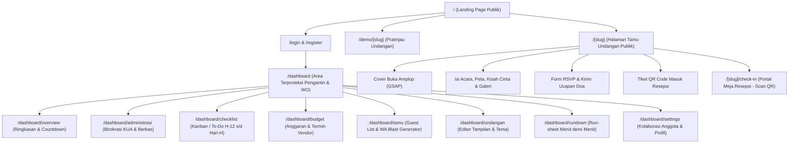
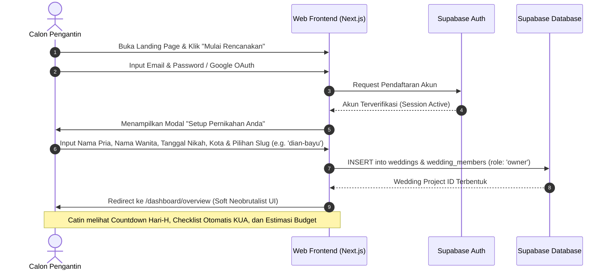
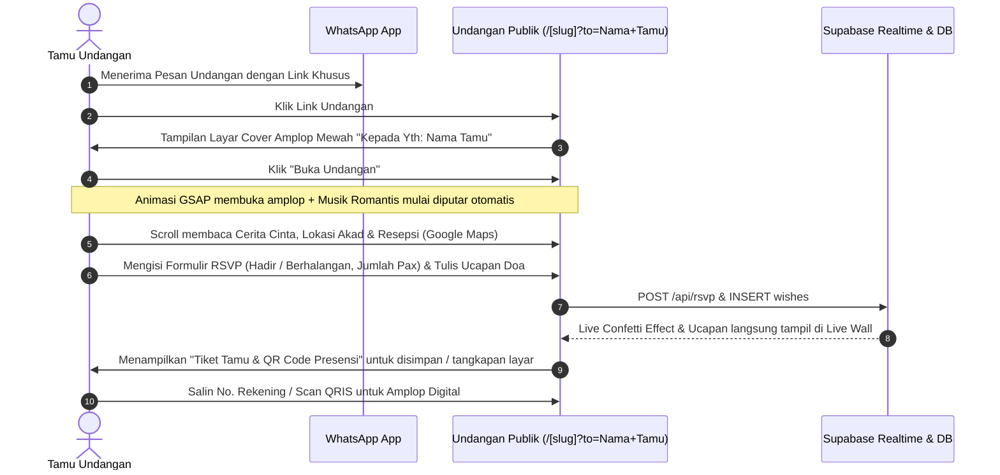
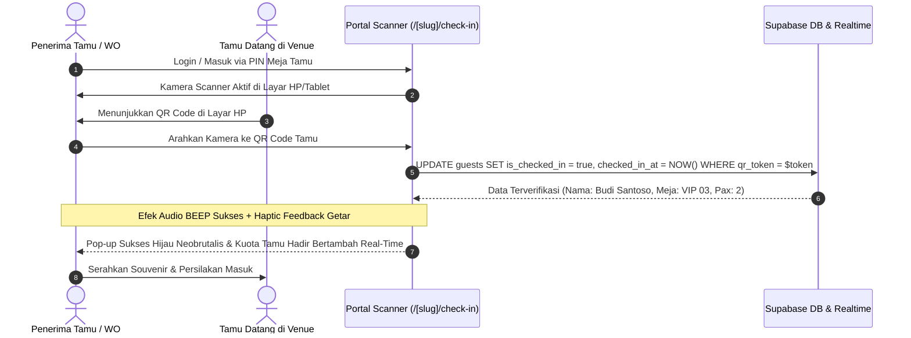
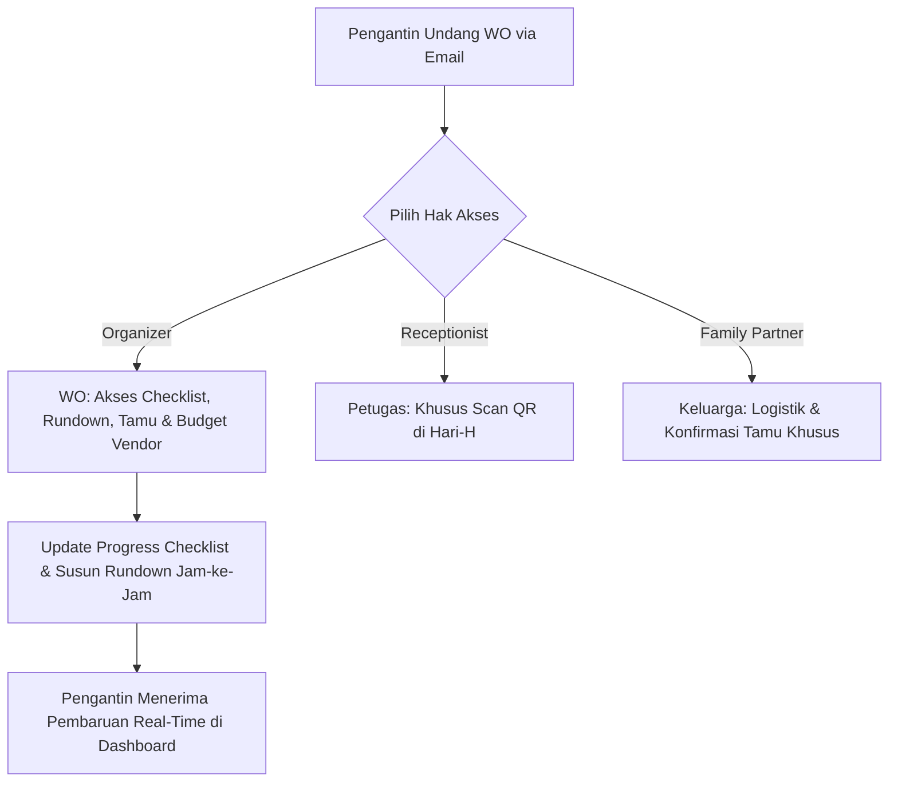

# RestuKisah: User Journey & Flowchart (`flow.md`)

**Platform:** Next.js Multi-Tenant SaaS Wedding Operating System
**Design Pattern:** Mobile-First, Realtime Sync, Soft Neobrutalism UI

---

## 1. Peta Situs Keseluruhan (Sitemap & Routing)

---

## 2. Alur Perjalanan Pengguna (User Journeys)

### 2.1 Alur Calon Pengantin (Onboarding ke Dashboard)

Tujuan: Pasangan mendaftarkan pernikahan baru, mendapatkan URL slug unik, dan langsung dapat mengatur persiapan.

---

### 2.2 Alur Tamu Undangan (Guest Experience: WhatsApp $\rightarrow$ RSVP $\rightarrow$ QR Pass)

Tujuan: Tamu membuka tautan undangan personal, menikmati animasi sinematik, konfirmasi kehadiran, dan mendapatkan QR Code masuk.

---

### 2.3 Alur Petugas Meja Resepsi (Check-In Tamu Hari-H)

Tujuan: Menghindari antrean panjang, mencatat kehadiran tamu dengan cepat tanpa kertas, dan memantau kapasitas catering real-time.

---

### 2.4 Alur Wedding Organizer & Kolaborasi Anggota

Tujuan: WO dan keluarga membantu mencicil tugas tanpa mengganggu data pribadi pengantin.

